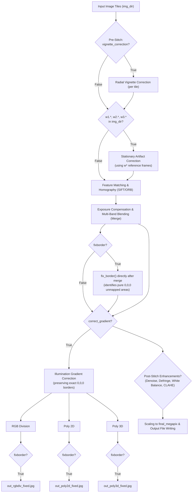

# LfStitch: Python Tool for Image Stitching & Microscope Panoramas

[](https://github.com/LucasFoe/LfStitch)
[](https://github.com/LucasFoe/LfStitch/blob/main/LICENSE)
[](https://www.python.org/)

**LfStitch** is a Python tool designed for automated image stitching, scientific microscopy panorama generation, and post-processing using OpenCV and NumPy. It provides intelligent feature matching, homography estimation, multiband blending, exposure compensation, illumination gradient correction (pseudo flat-field), optical aberration correction, and intelligent border filling.

Repository URL: [https://github.com/LucasFoe/LfStitch](https://github.com/LucasFoe/LfStitch)

---

## Workflow & Processing Architecture

LfStitch executes a structured, multi-phase pipeline where each step is applied at the optimal stage of image reconstruction:



### When Each Processing Step is Applied

1. **Phase 1: Pre-Stitching (Individual Tiles)**
   * **`vignette_correction`**: Optical lens vignetting (radial light fall-off) is concentric to the lens center of *each individual camera tile*. Correcting this *before* matching and blending prevents darker seams and circular tile patterns across the mosaic.

2. **Phase 2: Core Stitching (`SimpleStitcher`)**
   * **Stationary Artifact Correction (Automatic via `w1.*`, `w2.*`, `w3.*`)**: If shifted blank/near-empty reference frames named `w1.*`, `w2.*`, `w3.*` (e.g., `w1.tif`, `w2.tif`, `w3.tif`) exist in `img_dir`, they are automatically excluded from stitching and passed to `SimpleStitcher.correct_stationary_artifacts()` to compute the stationary background via per-pixel median (rejecting stray slide particles) and remove uneven illumination, vignetting, color shading, smudges, and localized dust *before* feature matching. If no `w*.*` reference frames are present, this step is skipped.
     * *Reusing `w1`, `w2`, `w3` across projects:* The same reference frames can be copied into multiple `img_dir` folders as long as the camera (same resolution, not rotated/remounted) and optical setup (same objective lens, condenser/aperture, and illumination alignment) remain unchanged; minor brightness/exposure differences are handled automatically. Retake them if you change magnification, adjust condenser/lamp settings, rotate/remount the camera, or notice new sensor/optics dust.
   * **Background Equalization & Feature Matching**: SIFT or ORB detects feature keypoints and matches overlapping frames via RANSAC.
   * **Exposure Compensation**: Multiplicative gain estimation harmonizes exposure variations between tiles.
   * **Multi-Band Pyramid Blending**: Blends overlapping regions across spatial frequency bands to avoid visible seams.
   * **Merge Output**: Returns the unscaled stitched canvas where all non-image areas outside the tiles are strictly pure black `(0, 0, 0)`.

3. **Phase 3: Direct Border Fix & Illumination Gradient Correction**
   * **Direct Border Fix (`fixborder = True`)**:
     * Applied directly after the merge step on the raw, unscaled canvas while unmapped canvas regions are strictly distinct from specimen content.
     * **Coverage Mask & Perimeter Tracking**: Uses `SimpleStitcher.last_coverage_mask` and connected perimeter analysis to distinguish unmapped outer canvas from internal image data. **Pure black pixels `(0, 0, 0)` inside the specimen (e.g. dark spores, cell structures, optical extinction) are 100% preserved and never overwritten.**
     * **Adaptive Local Color Matching**: Each unmapped border component independently samples the median color of valid image pixels directly bordering that specific region, guaranteeing an exact local color and brightness match along every edge (e.g. darker corners are filled with matching darker tones, not glaring white).
   * **Gradient Correction (`correct_gradient = True`)**:
     * Unmapped regions `(0, 0, 0)` are excluded from background estimation so they do not distort the illumination fit.
     * Generates:
       - `output_rgb_division.jpg`: Morphological flat-field division.
       - `output_poly2d.jpg`: 2D polynomial surface fit of degree 2 ($z = c_0 + c_1 x + c_2 y + c_3 x^2 + c_4 x y + c_5 y^2$).
       - `output_poly3d.jpg`: 2D polynomial surface fit of degree 3 for complex lighting slopes.
     * If `fixborder = True`, `fix_border()` is also applied to each gradient variant directly on the unscaled raw data:
       - `out_rgbdiv_fixed.jpg`
       - `out_poly2d_fixed.jpg`
       - `out_poly3d_fixed.jpg`

4. **Phase 4: Post-Stitching Microscope Enhancements & Final Scaling**
   * **`denoise`**: Edge-preserving bilateral filtering cleans sensor noise while preserving sharp cell walls.
   * **`defringe`**: Detects high-contrast edge boundaries and desaturates chromatic color fringing (purple/green edges caused by lens dispersion).
   * **`bg_white_balance`**: Samples upper brightness percentiles of the specimen background and balances RGB gains, neutralizing yellow/orange halogen or LED lamp casts to neutral white/gray.
   * **`local_contrast`**: Applies CLAHE (Contrast Limited Adaptive Histogram Equalization) to the luminance channel in LAB color space, bringing out fine cell structures without hue distortion.
   * **Final Resizing (`final_megapix`)**: Downsamples the results to the target megapixels at the very end. Because borders in `*fixed.jpg` are already filled with background color, downsampling produces no dark edge bleeding.

---

## Configuration (`stitch.ini`)

LfStitch reads its settings from `stitch.ini` in the current working directory. Sensible defaults are used if options are omitted.

```ini
[OPTIONS]
img_dir = ./img
out_dir = ./result
final_megapix = 5
confidence_threshold = 0.5
output = output
fixborder = True
detector = sift
correct_gradient = True

# Microscope optical enhancements (Default: False)
bg_white_balance = False
defringe = False
vignette_correction = False
local_contrast = False
denoise = False
```

### Configurable Options Reference

| Option | Type | Default | Description |
| :--- | :--- | :--- | :--- |
| `img_dir` | string | `./img` | Directory containing input image tiles. |
| `out_dir` | string | `./result` | Directory where stitched results are saved. |
| `output` | string | `output` | Base filename for the stitched outputs. |
| `confidence_threshold` | float | `0.5` | Threshold for selecting image matches (determines minimum RANSAC inliers). |
| `final_megapix` | float | `5.0` | Maximum resolution limit (in megapixels) for the output image. |
| `detector` | string | `sift` | Feature detector algorithm (`sift`, `orb`, etc.). |
| `fixborder` | boolean | `True` | Replaces unmapped black border regions with boundary-matched color (`*fixed.jpg`). |
| `correct_gradient` | boolean | `True` | Generates 2D polynomial and RGB division illumination-corrected images. |
| `bg_white_balance` | boolean | `False` | Neutralizes microscope lamp color cast on the background. |
| `defringe` | boolean | `False` | Suppresses chromatic aberration color fringing on high-contrast edges. |
| `vignette_correction` | boolean | `False` | Corrects radial light fall-off (vignetting) on input tiles before stitching. |
| `local_contrast` | boolean | `False` | Enhances micro-contrast and fine cellular details via CLAHE in LAB space. |
| `denoise` | boolean | `False` | Applies edge-preserving bilateral denoising to reduce sensor noise. |

---

## Border Fix (`fixborder`): Details & Behavior

### Why Border Fix Is Needed
When multiple overlapping images are registered and warped, the perimeter of the panorama is irregular and stepped. The empty canvas outside the warped images remains unmapped (black pixels). `fix_border` eliminates these stepped black borders to produce a complete rectangular panorama.

### Key Implementation Principles
1. **Direct Post-Merge Execution**:
   * Executed directly after blending on the full-resolution unscaled canvas.
   * Applying border fix *before* `final_megapix` resizing prevents anti-aliasing interpolation from blurring the sharp black borders into dark transition zones.
2. **Preservation of Interior `(0, 0, 0)` Pixels**:
   * Uses `SimpleStitcher.last_coverage_mask` (warped tile footprint) and perimeter connectivity analysis.
   * Only black regions connected to the outer edges of the canvas are recognized as unmapped borders.
   * Real black pixels inside the specimen (spores, cell walls, optical extinction) do not touch the outer canvas perimeter and are **strictly preserved**.
3. **Adaptive Local Boundary Color Matching**:
   * Instead of assigning a global percentile or fixed luminance across wide regions, each connected unmapped border component independently samples valid image pixels along its own adjacent edge.
   * A darker corner (e.g. `[130, 135, 126]`) is filled with its matching local tone, while a brighter edge is filled with its respective bright tone.
   * A subtle morphological seam dilation (`extend = 5`) covers the multi-band pyramid transition ramp without bleeding into bright specimen details.
4. **Conditional Output File Generation**:
   * `output.jpg`, `output_rgb_division.jpg`, `output_poly2d.jpg`, and `output_poly3d.jpg` are intentionally preserved **with** the unmapped black borders for inspection or custom manual cropping.
   * Border filling is applied specifically to the **`*fixed.jpg`** files: `outputfixed.jpg`, `out_rgbdiv_fixed.jpg`, `out_poly2d_fixed.jpg`, and `out_poly3d_fixed.jpg`.
   * If `fixborder = False` or `correct_gradient = False`, the corresponding output files are not generated (and any existing ones are cleaned up).

---

## Output Files Summary

When `correct_gradient = True` and `fixborder = True`, the following files are produced in `out_dir`:

| Output Filename | Description |
| :--- | :--- |
| `output.jpg` | Raw stitched panorama (contains unmapped black borders). |
| `outputfixed.jpg` | Raw panorama with unmapped borders filled. |
| `output_rgb_division.jpg` | Illumination corrected via morphological RGB division (borders black). |
| `output_poly2d.jpg` | Illumination corrected via 2D 2nd-degree polynomial surface (borders black). |
| `output_poly3d.jpg` | Illumination corrected via 2D 3rd-degree polynomial surface (borders black). |
| `out_rgbdiv_fixed.jpg` | RGB division corrected image with borders filled. |
| `out_poly2d_fixed.jpg` | Poly 2D corrected image with borders filled. |
| `out_poly3d_fixed.jpg` | Poly 3D corrected image with borders filled. |

---

## Installation & Setup

### Prerequisites
- Python 3.8+ (64-bit recommended)
- `pip` package manager

### 1. Clone the Repository
```bash
git clone https://github.com/LucasFoe/LfStitch.git
cd LfStitch
```

### 2. Install Dependencies
```bash
pip install -r requirements.txt
```

---

## Usage

### Running via Python
```bash
python src/stitch.py
```

### Running Tests
```bash
cd test
python -m unittest discover
```

### Building Standalone Executable (PyInstaller)
- **Windows**: Run `stitch.cmd` or:
  ```cmd
  pyinstaller stitch.spec
  ```
- **Linux / macOS**:
  ```bash
  pyinstaller --onefile --name stitch src/stitch.py
  ```

---

## License

This project is open-source and licensed under the [MIT License](LICENSE).
